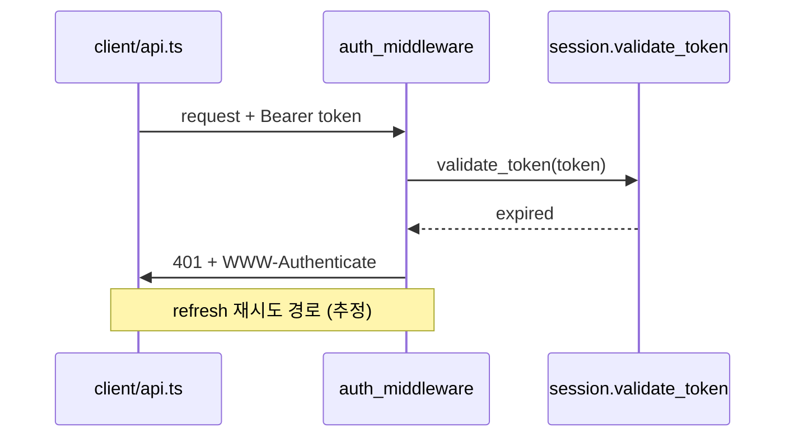

# diagram — 관계를 보여주는 Mermaid 그림

요소 사이의 관계가 이해를 막을 때 쓴다. 응답 안에 ```mermaid 블록으로 넣는다.
파일로 남길 정식 도해(팔레트, SVG 렌더)는 `mermaid-diagram` 스킬을 쓴다.

## 1. 종류 고르기

| 보여줄 것 | 종류 |
|---|---|
| 처리 흐름, 분기, 데이터 경로 | `flowchart` |
| 시간 순서의 상호작용 (누가 누구를 언제 부르나) | `sequenceDiagram` |
| 상태와 전이 | `stateDiagram-v2` |
| 클래스·모듈 구조, 소유 관계 | `classDiagram` |
| 데이터 모델, 테이블 관계 | `erDiagram` |

"흐름이 어떻게 이어지는지"가 질문이고 참여자가 셋 이상이면 `sequenceDiagram` 을 먼저 검토한다.

## 2. 규칙

- **노드는 12개 이하.** 넘으면 개요 그림 1개 + 상세 그림 N개로 나눈다.
  개요의 각 노드가 어느 상세 그림으로 이어지는지 라벨에 적는다 (예: `Auth["인증 (상세 1)"]`).
- **라벨에는 실제 이름을 쓴다.** 함수, 파일, 컴포넌트, 테이블 이름. "Service A", "모듈" 같은 일반 명사를 쓰지 않는다.
- **확인된 관계는 실선, 추정한 관계는 점선.**
  - flowchart: `-->` 확인, `-.->` 추정
  - sequenceDiagram: `->>` 확인, `-->>` 은 응답이므로 추정에는 `Note over` 로 "(추정)" 표기
  - classDiagram: `-->` 확인, `..>` 추정
- 추정 관계가 하나라도 있으면 그림 바로 아래에 범례 한 줄을 쓴다: "실선 = 코드에서 확인, 점선 = 추정".
- 라벨에 괄호·콜론·따옴표가 들어가면 `["..."]` 로 감싼다 (파서 오류 방지).

## 3. 예시



## 4. 그림 아래에 쓸 것

### 읽어야 할 핵심 3가지

정확히 세 개. 그림만 보고 놓치기 쉬운 것을 고른다.

1. 
2. 
3. 

그 다음 [확인된 사실] / [추론] / [불확실] (SKILL.md 4.1). 점선으로 그린 관계는 [추론] 에 같이 적는다.

## 5. 상위 포맷 제안

관계는 이해했는데 "이 값이 바뀌면 경로가 어떻게 달라지나"가 남으면 html 을 한 줄로 제안한다.
